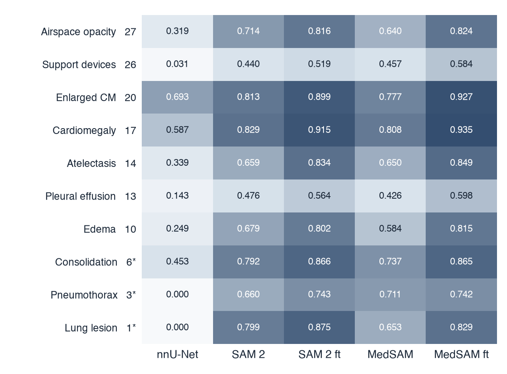
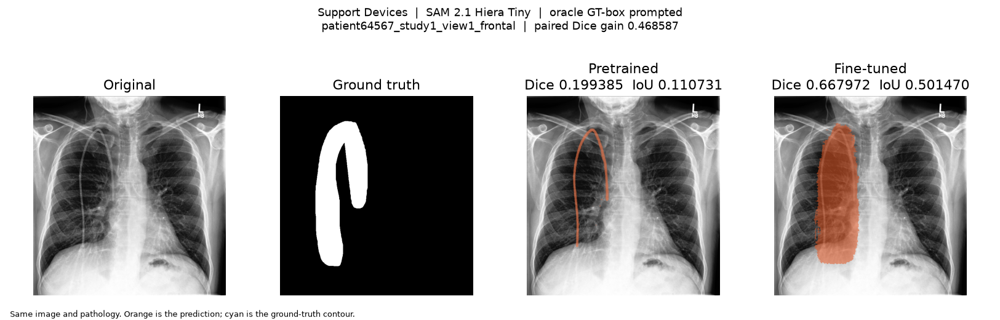
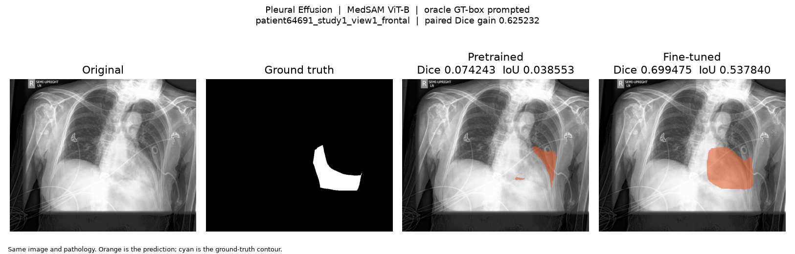
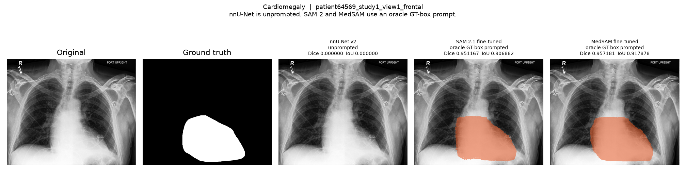

# CheXlocalize: Multi-Pathology Chest X-Ray Segmentation

A reproducible chest X-ray segmentation study evaluating **nnU-Net [2], SAM 2.1 [3], and MedSAM [4] across 10 radiologist-annotated pathologies** from CheXlocalize [1]. The primary question is whether task-specific fine-tuning improves prompt-based foundation models for medical image segmentation.


## Research Question

**How much does task-specific fine-tuning improve SAM 2 [3] and MedSAM [4] for chest X-ray pathology segmentation when approximate pathology location is provided?**

To provide a separate end-to-end reference, I also trained a 10-pathology **nnU-Net v2 [2]** model that receives only the chest X-ray and must localize and segment findings without a bounding-box prompt.

Because nnU-Net is unprompted while SAM 2 and MedSAM receive ground-truth-derived bounding boxes, their absolute scores represent different inference settings and should not be interpreted as a pure architecture leaderboard.

## Experimental Design

The project uses **CheXlocalize [1]**, which provides radiologist localization annotations for findings on CheXpert [5] chest radiographs.

Ten segmentation targets were modeled:

**Atelectasis · Cardiomegaly · Consolidation · Edema · Enlarged Cardiomediastinum · Lung Lesion · Airspace Opacity · Pleural Effusion · Pneumothorax · Support Devices**

### Why this design?

**Patient-level splitting.**
Training and internal-validation sets were separated by patient rather than image to prevent multiple studies from the same patient from appearing across both sets.

**Multi-label segmentation.**
Pathology masks can spatially overlap. Each finding was therefore represented as an independent binary segmentation target rather than forcing pixels into mutually exclusive classes.

**Positive-only headline evaluation.**
Headline Dice and IoU metrics use cases with a non-empty localization mask. This prevents large numbers of correctly empty predictions from artificially increasing segmentation performance.

**Oracle-box prompting.**
SAM 2 and MedSAM receive a tight bounding box derived from the ground-truth mask. This intentionally isolates **segmentation performance given localization** from the separate problem of automatically detecting where a pathology is located.

**Controlled pretrained vs. fine-tuned comparisons.**
Pretrained and fine-tuned versions of each foundation model are evaluated on the exact same image–pathology pairs using the same prompting and scoring pipeline.

## Models

### nnU-Net v2 — Unprompted baseline

nnU-Net [2] receives the chest X-ray directly and predicts the pathology segmentation masks without localization prompts.

This represents the more difficult end-to-end setting in which the model must both identify where a finding is located and delineate its extent.

### SAM 2.1 Hiera Tiny

SAM 2 [3] is evaluated in two conditions:

- **Pretrained:** original model weights
- **Fine-tuned:** model adapted using the CheXlocalize training split

Both conditions receive the same ground-truth-derived bounding-box prompts.

### MedSAM ViT-B

MedSAM [4] is similarly evaluated before and after task-specific fine-tuning using the same oracle-box prompting protocol.

This enables a controlled test of whether adapting a medical segmentation foundation model to this specific chest X-ray task improves segmentation quality.

## Official Test Results

The official test is the primary evaluation. It was scored after the checkpoints and procedures were frozen.

The official test annotations had previously been inspected for dataset-level overlap/schema analysis, but test performance was not used for training, checkpoint selection, thresholds, early stopping, or hyperparameter tuning.

The scored set is **1,534 VALID_POSITIVE pairs**, from **499 images** and **403 patients**. All five conditions scored **1,534 / 1,534** pairs. Intervals use 5,000 resamples and seed 42.

nnU-Net is unprompted. SAM 2 and MedSAM receive oracle ground-truth boxes. These are different inference settings and are not a pure architecture ranking.

| Model | Setting | Mean Dice | 95% CI | Mean IoU | Median Dice |
| --- | --- | ---: | --- | ---: | ---: |
| nnU-Net v2 | Unprompted, epoch 7 | 0.310 | [0.294, 0.326] | 0.234 | 0.162 |
| SAM 2.1 | Pretrained + oracle box | 0.646 | [0.635, 0.657] | 0.512 | 0.703 |
| SAM 2.1 | Fine-tuned, epoch 12 + oracle box | 0.742 | [0.731, 0.753] | 0.630 | 0.826 |
| MedSAM | Pretrained + oracle box | 0.607 | [0.597, 0.618] | 0.467 | 0.644 |
| MedSAM | Fine-tuned, epoch 4 + oracle box | 0.772 | [0.763, 0.781] | 0.664 | 0.850 |

Source: [`results/test/summary_test_results.csv`](results/test/summary_test_results.csv). Full precision is in [`results/test/summary_test_results.md`](results/test/summary_test_results.md).

## Internal Validation

Internal validation was used to choose checkpoints. It is a development result, not the headline.

The same five conditions were scored on **137 VALID_POSITIVE pairs**.

| Model | Setting | Mean Dice | 95% CI | Mean IoU |
| --- | --- | ---: | --- | ---: |
| nnU-Net v2 | Unprompted supervised | 0.329 | [0.273, 0.386] | 0.252 |
| SAM 2.1 | Pretrained + oracle box | 0.663 | [0.624, 0.699] | 0.531 |
| SAM 2.1 | Fine-tuned + oracle box | 0.762 | [0.724, 0.798] | 0.655 |
| MedSAM | Pretrained + oracle box | 0.629 | [0.593, 0.662] | 0.488 |
| MedSAM | Fine-tuned + oracle box | 0.788 | [0.752, 0.821] | 0.687 |

Internal validation compared with the official test:

- nnU-Net: 0.329 → 0.310
- SAM 2 pretrained: 0.663 → 0.646
- SAM 2 fine-tuned: 0.762 → 0.742
- MedSAM pretrained: 0.629 → 0.607
- MedSAM fine-tuned: 0.788 → 0.772

Every model dropped only about 0.015–0.021 Dice. The fine-tuning gains remained similar on the official test set.

## Fine-Tuning Gains

On the official test, within each prompted model:

- SAM 2.1: **+0.096** Dice, 95% CI **[0.091, 0.102]**
- MedSAM: **+0.165** Dice, 95% CI **[0.158, 0.172]**

Neither paired interval includes zero. Source: [`results/test/test_finetuning_improvements.csv`](results/test/test_finetuning_improvements.csv).

On internal validation the same comparison was SAM 2 **+0.099** [0.082, 0.118] and MedSAM **+0.159** [0.137, 0.182].

## Per-Pathology Results

Official-test mean Dice was not uniform. Counts below are the same for every model. Source: [`results/test/test_per_pathology_results.csv`](results/test/test_per_pathology_results.csv).

**Cardiomegaly** (n=175) and **Enlarged Cardiomediastinum** (n=297) were comparatively strong. Fine-tuned mean Dice was 0.914 and 0.904 for SAM 2, and 0.920 and 0.914 for MedSAM.

**Pleural Effusion** (n=120) and **Support Devices** (n=314) were harder, especially for unprompted nnU-Net (mean Dice 0.134 and 0.030).

Fine-tuning raised mean Dice for every pathology in SAM 2. It raised mean Dice for nine MedSAM pathologies. MedSAM **Pneumothorax** (n=10) moved from 0.645 to 0.595.

**Pneumothorax** (n=10) and **Lung Lesion** (n=14) are the smallest official-test groups. Unprompted nnU-Net mean Dice was 0.000 on both.

The heatmap below is the internal-validation set, where Consolidation, Pneumothorax, and Lung Lesion had fewer than 10 pairs.



## Qualitative Results

The examples below are internal-validation films chosen from the saved scores. They are not official-test cases. Quantitative improvement did not always produce anatomically perfect masks.

### Fine-tuning improves coverage

For both SAM 2 and MedSAM, fine-tuned predictions often captured substantially more of the labeled pathology than their pretrained counterparts.





### Thin and irregular structures remain difficult

Support devices and small peripheral findings were particularly challenging. In several examples, fine-tuning increased mask coverage while producing shapes that remained more rectangular or box-like than the ground truth.

### Localization remains a separate problem

Some findings that were successfully segmented by oracle-prompted SAM 2 or MedSAM were completely missed by the unprompted nnU-Net model.

This highlights an important distinction: **providing the approximate location of the pathology substantially changes the segmentation problem.**



Full gallery: [`results/final/qualitative/`](results/final/qualitative/).

## Evaluation

Segmentation performance was measured using:

- **Dice coefficient**
- **Intersection over Union (IoU)**
- per-pathology performance
- qualitative prediction analysis
- paired pretrained → fine-tuned comparisons
- **5,000-sample bootstrap confidence intervals**, seed 42

## Reproducibility and Engineering

The project includes:

- reproducible preprocessing and mask decoding
- patient-level split validation
- overlapping multi-label target generation
- checkpointed model training
- early stopping
- saved per-pair predictions
- harmonized evaluation manifests
- automated Dice/IoU scoring
- per-pathology analysis
- bootstrap uncertainty estimation
- qualitative failure analysis
- GPU training and inference using **PyTorch** and **RunPod**

Selected checkpoints:

- **nnU-Net:** epoch 7
- **SAM 2:** epoch 12
- **MedSAM:** epoch 4

```bash
python -m venv .venv && source .venv/bin/activate
pip install -r requirements.txt
python scripts/validate_project.py
pytest -q
python scripts/preprocess.py
```

`preprocess.py` expects the dataset on disk. Model environments are documented separately: [nnU-Net](docs/nnunet.md), [SAM 2](docs/sam2.md), [MedSAM](docs/medsam.md).

## Limitations

This project has several important limitations.

**Oracle prompting.**
SAM 2 and MedSAM receive bounding boxes derived from ground-truth masks. Their reported performance therefore measures segmentation given localization, not automatic pathology detection and segmentation.

**Different model protocols.**
nnU-Net receives no localization prompt. Direct numerical comparisons between nnU-Net and the prompted models should therefore not be interpreted as an architecture ranking.

**Checkpoint selection.**
Checkpoints were selected on the internal-validation split. The official test was scored only after that choice was frozen.

**Small pathology groups.**
On the official test, Pneumothorax has 10 positive pairs and Lung Lesion has 14. Several internal-validation pathology groups were smaller still.

**Bootstrap dependence.**
Some evaluated image–pathology pairs come from the same image or patient, so pair-level bootstrap intervals may underestimate dependence.

**Clinical use.**
This project is a research segmentation study and has not been validated for clinical deployment.

## Reproducibility note

The first MedSAM pretrained launch on the official test raised `NameError: name 'torch' is not defined`. It occurred before any pair was scored. The resumed run completed all 1,534 pairs. Weights and thresholds were unchanged.

## Tools

**Machine learning:** PyTorch, nnU-Net v2, SAM 2.1, MedSAM
**Data:** NumPy, pandas, scikit-image, pycocotools
**Evaluation:** Dice, IoU, bootstrap confidence intervals
**Infrastructure:** RunPod A100, Git

The interactive page is [`frontend/index.html`](frontend/index.html).

## Dataset and References

This project uses **CheXlocalize [1]**, which provides radiologist localization annotations on CheXpert [5] chest radiographs.

1. Saporta et al. Benchmarking saliency methods for chest X-ray interpretation. *Nature Machine Intelligence* (2022). [10.1038/s42256-022-00536-x](https://doi.org/10.1038/s42256-022-00536-x). Dataset: [10.71718/hap9-kn94](https://doi.org/10.71718/hap9-kn94).
2. Isensee et al. nnU-Net: a self-configuring method for deep learning-based biomedical image segmentation. *Nature Methods* 18, 203–211 (2021). [10.1038/s41592-020-01008-z](https://doi.org/10.1038/s41592-020-01008-z).
3. Ravi et al. SAM 2: Segment Anything in Images and Videos. *International Conference on Learning Representations* (2025). [arXiv:2408.00714](https://arxiv.org/abs/2408.00714).
4. Ma et al. Segment anything in medical images. *Nature Communications* 15, 654 (2024). [10.1038/s41467-024-44824-z](https://doi.org/10.1038/s41467-024-44824-z).
5. Irvin et al. CheXpert: a large chest radiograph dataset with uncertainty labels and expert comparison. *AAAI* (2019). [10.1609/aaai.v33i01.3301590](https://doi.org/10.1609/aaai.v33i01.3301590).

This repository has no `LICENSE` file. The dataset and model weights keep their own licenses.
