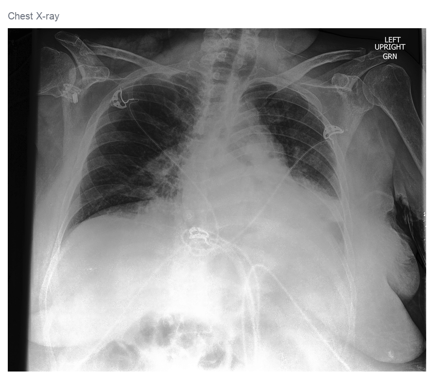

# Chest X-Ray Segmentation

This project evaluates whether task-specific fine-tuning improves SAM 2.1 and MedSAM for segmentation of 10 chest X-ray findings in CheXlocalize, with nnU-Net as a separate unprompted supervised baseline.

🌐 Project website:
https://chawladiti.github.io/chest-xray-segmentation/

  

  Representative internal-validation example comparing ground truth and model predictions.

## Results

- SAM 2.1: Dice 0.646 → 0.742 after fine-tuning
- MedSAM: Dice 0.607 → 0.772 after fine-tuning
- nnU-Net unprompted baseline: Dice 0.310

The project website contains the full methodology, pathology-level analysis, qualitative examples, and limitations.

## Data

The project uses CheXlocalize, which provides radiologist localization annotations on CheXpert chest X-rays.

CheXlocalize and CheXpert data are not redistributed in this repository and should be obtained from the original sources under their applicable terms.

CheXlocalize dataset DOI: https://doi.org/10.71718/hap9-kn94

## Models

- nnU-Net v2
- SAM 2.1 Hiera Tiny
- MedSAM ViT-B
